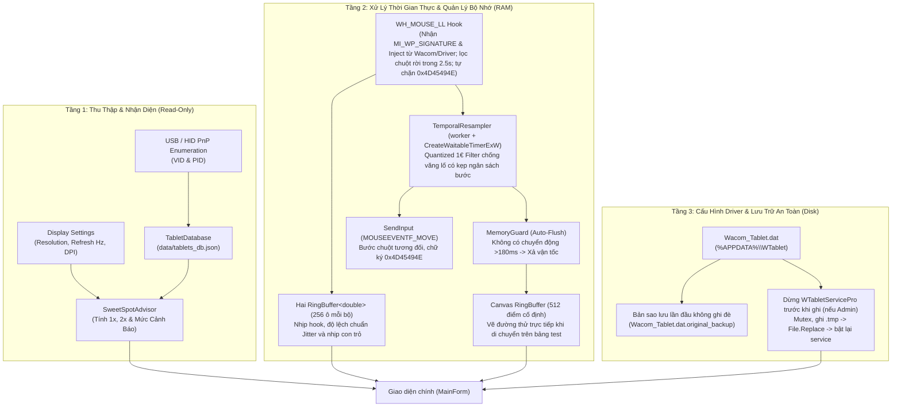

# Sơ Đồ Tư Duy & Bất Biến Thiết Kế — Meinya Tablet Booster (`MINDMAP.md`)

> **Tác giả:** `Elainabaka`  
> **Mục đích tài liệu này:** Giúp người dùng, lập trình viên và **các AI Agent khác (Codex, Claude, Gemini...)** khi vào đọc hoặc kiểm toán (audit) repository này hiểu ngay **mục đích ban đầu**, **luồng dữ liệu**, **nơi lưu trữ dữ liệu tạm**, và **các quy tắc bất biến (Design Invariants)** không bao giờ được phép vi phạm.

---

## Công cụ làm gì / không làm gì

Chèn bước chuột tương đối dự đoán từ vận tốc cũ qua `SendInput` / `MOUSEEVENTF_MOVE`; mẫu bút thật kế tiếp có thể kéo con trỏ về đầu bút. Bước này chịu tốc độ con trỏ và Enhance pointer precision của Windows, chỉ có thể hữu ích với ứng dụng nhận con trỏ (ví dụ osu! chế độ chuột; cần tự thử).

Không tăng report rate phần cứng, không thêm tọa độ hay lực nhấn vào WinTab/Windows Ink. Hai luồng bút này không đi qua bộ làm mượt. Nhịp mục tiêu 1x/2x không đồng bộ khung hình, không bảo đảm độ trễ. Hz trong hồ sơ và ngưỡng phần mềm hiện tại đều là **ước lượng**, khác với tần số màn hình được đọc từ hệ điều hành. PacketRate là giá trị cấu hình Wacom có đơn vị chưa được hãng công bố.

## 1. Mind Map Tổng Quan Dự Án

```mermaid
mindmap
  root((Meinya Tablet Booster<br/>by Elainabaka))
    Mục tiêu cốt lõi
      Đo nhịp sự kiện chuột hook (không phải report rate USB)
      Thử làm mượt con trỏ bằng bước chuột tương đối dự đoán
      Chỉnh khóa Wacom đã có (PacketRate chưa công bố đơn vị)
      Khôi phục bản sao lưu lần đầu nếu còn nguyên vẹn
    Nhận diện & Tư vấn thông minh
      Quét USB/HID (pnputil) khớp với CSDL data/tablets_db.json
      Đọc tần số quét màn hình thực tế (EnumDisplaySettings)
      Tính Điểm Ngọt (Sweet Spot)
        1x Monitor Hz (nhịp mục tiêu tham khảo)
        2x Monitor Hz (không khóa pha màn hình)
      Cảnh báo 3 mức
        Xanh (trong ngưỡng phần mềm ước lượng)
        Vàng (vượt ngưỡng tham khảo hoặc hệ số cao)
        Đỏ (nhịp mục tiêu cao theo điều kiện tư vấn)
    Quản lý Dữ liệu & Bộ nhớ (3 Tầng)
      Tầng 1: Phần cứng Tablet (không đọc MCU hay sửa firmware)
      Tầng 2: RAM (mảng vòng cố định, worker xả vận tốc sau 180ms)
      Tầng 3: Ổ cứng (Atomic File Swap .tmp -> .dat, khóa .original_backup)
    Giao diện & Trải nghiệm
      Chuẩn High-DPI (GraphicsUnit.Pixel + UseMnemonic=false)
      Bảng vẽ thử trực tiếp (512 điểm vòng tròn)
      Bảng chú thích thuật ngữ tiếng Việt dễ hiểu
      Mascot Meinya (PNG Alpha gốc) + Góc tác giả Elainabaka
```

---

## 2. Luồng Dữ Liệu & Kiến Trúc Từng Module (`Architecture Flowchart`)



---

## 3. Bảng Quy Tắc Bất Biến (`Design Invariants` — Dành Cho AI Kiểm Toán Code)

Khi một AI (như Codex `gpt-6.1-sol`, Claude, Gemini) vào kiểm tra lỗi của dự án này, hãy đối chiếu code trong `src/` với **7 quy tắc bất biến** dưới đây. Nếu bất kỳ dòng code nào vi phạm 1 trong 7 quy tắc này, đó là **LỖI NGHIÊM TRỌNG (BUG)** so với thiết kế ban đầu:

| Mã | Quy tắc bất biến (Invariant) | Mục đích bảo vệ | Cách kiểm tra trong Code |
|---|---|---|---|
| **INV-1** | **Không bao giờ tự lặp vô tận (No Hook Feedback Loop)** | Khi `TemporalResampler` bơm điểm nội suy qua `SendInput`, nó phải gắn chữ ký `dwExtraInfo = 0x4D45494E` (`"MEIN"`). Hàm `EvaluateHookMouseMove` / `HookCallback` khi thấy chữ ký `0x4D45494E` **phải bỏ qua ngay** (`isSelfInjected = true`), không tính vào `Raw Hz` và không kích hoạt nội suy chồng lên chính nó (vẫn cho phép nhận gói `LLMHF_INJECTED` từ driver Wacom/OpenTabletDriver bên thứ ba). | Kiểm tra `EvaluateHookMouseMove` và `HookCallback` trong `src/ResamplerAndMemory.cs`. |
| **INV-2** | **Không phình bộ nhớ RAM (Zero Unbounded Allocation)** | Lịch sử thời gian đo Hz và lịch sử các điểm vẽ trên bảng test **bắt buộc dùng mảng vòng cố định (`FixedRingBuffer<T>`)** với kích thước trần (`256` và `512`). Tuyệt đối không dùng `List<T>.Add()` không giới hạn trong luồng 1000 Hz hoặc luồng vẽ. | Kiểm tra `FixedRingBuffer<T>` và chạy `--self-test` với 100.000 điểm liên tiếp xem số phần tử có bị vượt trần không. |
| **INV-3** | **Tự xả đệm vận tốc khi nhấc bút (Idle Velocity Flush)** | Khi người dùng ngừng di chuyển bút quá `180 ms`, bộ nội suy phải tự động dừng bơm điểm và xóa sạch vận tốc cũ (`ResetVelocityState()`). Mẫu nhảy xa `> 80 px` hoặc khoảng thời gian không đủ điều kiện tính vận tốc phải xả vận tốc; canvas không nối hai đoạn qua bước nhảy/khoảng nghỉ. Đây là suy ra từ chuyển động, không phải đọc trạng thái nhấc bút. | Kiểm tra `ResamplerWorkerLoop` và `ProcessRawHardwareSample` trong `src/ResamplerAndMemory.cs`. |
| **INV-4** | **Bản sao lưu gốc là bất biến (Immutable Original Backup)** | File `Wacom_Tablet.dat.original_backup` chỉ được tạo khi **chưa tồn tại**. Các lần bấm *"Lưu & Áp Dụng"* tiếp theo tuyệt đối không được ghi đè lên `.original_backup`, để Reset lấy lại nội dung lúc sao lưu lần đầu nếu bản sao lưu còn nguyên vẹn và có quyền đọc/ghi. Chưa có backup thì giữ nguyên tệp; không suy ra đây là cấu hình xuất xưởng. | Kiểm tra `EnsureOriginalBackup()` và `ApplyOptimizedConfig()` trong `src/WacomConfigManager.cs`. |
| **INV-5** | **Ghi file nguyên tử, không chồng lấn (Atomic File Write)** | Mọi thao tác sửa `Wacom_Tablet.dat` phải ghi ra file tạm `.tmp` cùng thư mục, kiểm tra nội dung khác rỗng và chỉ thay giá trị khóa đúng dạng đã tồn tại, sau đó tráo nguyên tử (`File.Replace` cho đích đã có, `File.Move` cho đích mới). Không tự chèn khóa thiếu theo `ThinLine` / `SendBatchedData`; báo rõ khóa bỏ qua. Không có thay đổi thì không ghi lại, giữ nguyên byte. | Kiểm tra `WriteBytesAtomically()` và bài test round-trip trong `src/WacomConfigManager.cs`. |
| **INV-6** | **An toàn hiển thị High-DPI & Ký tự `&` (DPI & Mnemonic Safe)** | Mọi `Font` trên giao diện phải tạo bằng đơn vị `GraphicsUnit.Pixel` đã nhân tỷ lệ `S(px)`. Mọi `Label`, `Button`, `CheckBox` hiển thị thông tin phải đặt `UseMnemonic = false` để không làm mất dấu `&` (như `VID_056A&PID_037A`) và không bị tràn chữ đè lên nhau ở màn hình scale 125%–150%. | Kiểm tra `src/MainForm.cs` và chạy `--ui-smoke-test` (tự động kiểm tra giao diện chồng lấn). |
| **INV-7** | **Không can thiệp Firmware / Phần cứng USB** | Công cụ chỉ làm việc ở tầng User-mode (chèn chuyển động chuột + chỉnh khóa đã có trong tệp Wacom). Không gửi lệnh đổi điện áp, firmware hay report rate xuống thiết bị. Không diễn giải điều này thành cam kết an toàn tuyệt đối, giữ lực nhấn hoặc tăng băng thông driver. | Kiểm tra toàn bộ lệnh gọi Win32 API trong `src/`. |

